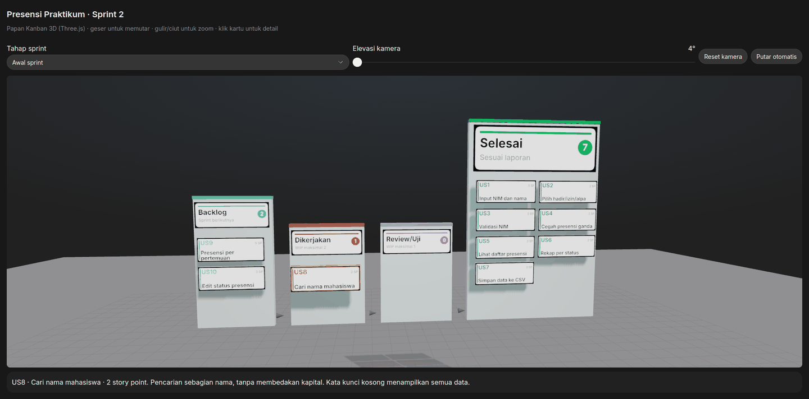

# Aplikasi Presensi Praktikum

Implementasi Agile untuk aplikasi presensi satu sesi praktikum. Sprint 2 menambahkan **US8: pencarian nama mahasiswa** agar dosen dapat menemukan data presensi tanpa membaca seluruh daftar.

Aplikasi presensi dijalankan melalui terminal dan menyimpan data dalam CSV. Papan Kanban 3D menampilkan simulasi perkembangan pekerjaan selama Sprint 2.

## Papan Kanban

[](https://ndeso17.github.io/mp-agile/)

**[Buka papan Kanban 3D interaktif](https://ndeso17.github.io/mp-agile/)**

GIF menampilkan tahap awal, pertengahan, dan akhir sprint, lalu contoh pemilihan kartu. Pada papan interaktif, pilih tahap sprint, putar papan, sesuaikan elevasi kamera, atau klik kartu untuk membaca detailnya.

### Pergerakan US8

| Tahap sprint | Posisi US8 | Jumlah kartu selesai |
| --- | --- | --- |
| Awal | Dikerjakan | 7 |
| Pertengahan | Review/Uji | 7 |
| Akhir | Selesai | 8 |

US1 sampai US7 merupakan fitur Sprint 1. US9, presensi per pertemuan, dan US10, edit status presensi, tetap berada di Backlog. Status pada papan mengikuti simulasi dalam laporan.

## Fitur tambahan: US8

> Sebagai dosen, saya ingin mencari nama mahasiswa agar dapat menemukan data presensi dengan cepat tanpa membaca seluruh daftar.

**Sprint:** 2 · **Prioritas:** Tinggi · **Estimasi:** 2 story point

Pencarian tersedia melalui menu **4. Cari nama**, dengan perilaku berikut:

- Mencocokkan sebagian nama, misalnya `Ayu` menemukan `Ayu Lestari` dan `Ayuningtyas`.
- Tidak membedakan huruf besar dan kecil, sehingga `ayu` dan `AYU` menghasilkan data yang sama.
- Mengabaikan spasi di awal dan akhir kata kunci.
- Menampilkan seluruh data jika kata kunci kosong atau hanya berisi spasi.
- Menampilkan pesan jika tidak ada nama yang cocok.
- Menghasilkan daftar kosong tanpa error jika berkas CSV belum tersedia.
- Mempertahankan urutan hasil sesuai urutan data dalam berkas.

Hasil pencarian memuat **NIM, nama, dan status kehadiran**. Pencarian membaca data tanpa mengubah isi CSV.

## Menjalankan aplikasi

Gunakan Python 3. Aplikasi hanya memakai pustaka standar Python, sehingga tidak memerlukan pemasangan paket tambahan.

```bash
python3 presensi.py
```

Menu aplikasi:

```text
1. Input presensi
2. Lihat daftar
3. Lihat rekap
4. Cari nama
5. Keluar
```

Masukkan data melalui menu **1**, lalu pilih menu **4** untuk mencari nama. Data tersimpan dalam `presensi.csv` di folder aplikasi. Status yang tersedia adalah `HADIR`, `IZIN`, dan `ALPA`.

## Pengujian

Jalankan pengujian fitur presensi dan pencarian nama:

```bash
python3 -m unittest -v
```

Tersedia **11 pengujian**: 6 untuk fitur presensi dan 5 untuk pencarian nama. Seluruh pengujian lulus saat README ini disusun. Pengujian memakai berkas sementara sehingga tidak mengubah data presensi aplikasi.

## Berkas proyek

| Berkas | Isi |
| :--- | :--- |
| [presensi.py](presensi.py) | Aplikasi terminal dan implementasi pencarian US8 |
| [test_presensi.py](test_presensi.py) | Pengujian otomatis presensi dan pencarian |
| [kanban-3d.html](kanban-3d.html) | Visualisasi Kanban 3D yang dipublikasikan melalui GitHub Pages |
| [docs/kanban-sprint.gif](docs/kanban-sprint.gif) | Animasi tahapan sprint dari screenshot |
| [KANBAN.md](KANBAN.md) | Detail kartu, alur pekerjaan, dan aturan Kanban |
| [LAPORAN.md](LAPORAN.md) | Laporan implementasi Agile |
| [](https://www.youtube.com/watch?v=WV9mHhcsZmU) | Video demo implementasi proyek |
